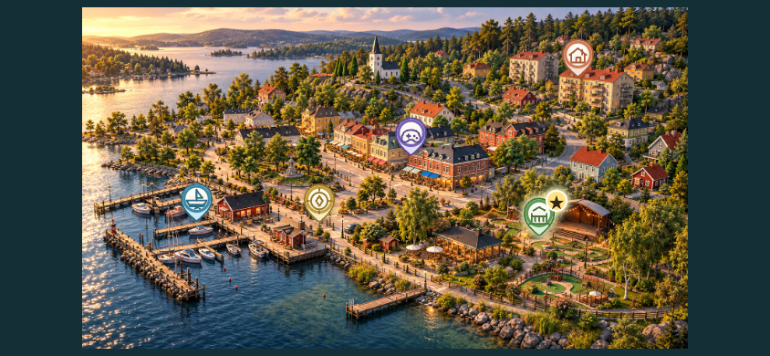
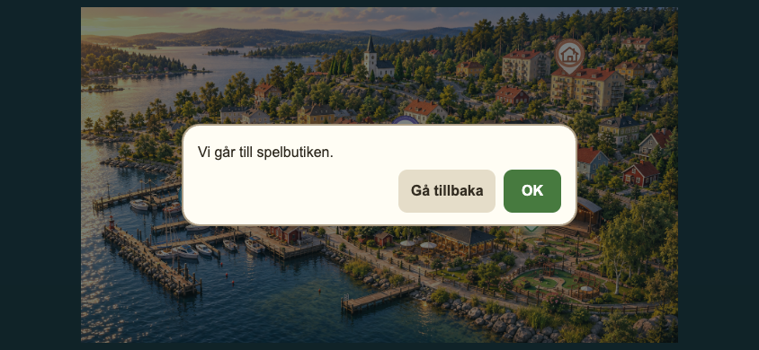

# Akt 3 stadskarta — implementation och verifiering 2026-10-13

Issue #9. Bas: `nova/runtime-architecture-v1` vid `0bdd6c663f8fe19e3a07dad1ef1d32f0ee74163a`. Arbetsbranch: `codex/act3-city-map-ui`.

## Levererat

- `Act3CityMap` tar `Act3CityMapVisibilityContext` och `onConfirmNode(Act3CityNodeId)`. Synlighet, namn och popuptext kommer från befintliga node-helpers.
- Oförändrad ren bakgrund och fem SVG-assets. ResizeObserver och befintliga geometrihelpers håller bilden och ikonlagret i samma contain-yta. Spetsen ligger vid SVG-koordinaten (62,102). Klickytorna är minst 44 px breda; sidan reserverar safe areas.
- Aktiv plats har stjärna, ljusmarkering och `aria-current="location"`, oberoende av questväntan. Dolda platser finns inte i DOM.
- Gemensam `ConfirmationDialog` återanvänder `DialogueCard` och native modalitet: fokus/bakgrundsspärr, Escape, återgång till utlösande knapp, OK/Gå tillbaka och skydd mot dubbla OK-anrop. Om en vald plats blir dold stängs popupen och återkommer inte när platsen visas igen.
- Befintlig `Act3Skeleton` och Runtime 1.1-host visar kartan först efter kapitelkortet. Vuxenläge → X och engångsgrant är kvar. Debug sparar inte kapitelintroduktion.
- Hamnens typade OK-val går via `chapterRoute("act2")` till befintlig sjö. Ingen BOAT-story, quest eller valuta konsumeras.

## Avsiktlig integrationsgräns

X-förhandsvisningen visar **endast hamnen**, utan aktiv storyplats. Det finns ännu ingen godkänd discovery-/beatkoppling. Övriga ikoner och active-state kan därför verifieras via komponenttester med uttrycklig testdata, inte via falsk spelprogression eller nya upplåsningstriggers.

`INITIAL_MAP_VISIBILITY` och `confirmCityNode` i `Act3Skeleton` markerar nästa integrationssteg: tillför framtida chapter-owned discovery/active state och routa övriga typade nodval till gemensam Story-host för nästa beat, väntan eller deadbeat. Denna slice implementerar inte OPEN-story, bestående upptäckter, questgates eller nya dialoger.

Save är fortsatt exakt `{ version: 1, entered: boolean }`. Alla 140 innehållsbeats och deras `mapLocationId: null` är oförändrade. Akt 1/2-kod, backend och tidigare sparningar har inte ändrats.

## Lokala resultat

- `npm run lint`: PASS, noll varningar. En redan befintlig oanvänd callbackparameter i `preflight-art-job.mjs` togs bort utan beteendeändring.
- `npm run build`: PASS, Next production static export inklusive TypeScript-kontroll.
- Node-sviterna för kartnodes, assets, geometri, nya UI-testet, innehållsregister, preview-gate och kapitelentry: PASS.
- `npm run verify`: **inte helt grön**. Av 47 delkommandon passerade 46, när resterande kommandon kördes separat efter första felet. `test:image-batch` fallerar på en befintlig sökvägskonflikt: registret använder `public/assets/character-sheets/`, medan `build-image-batch.mjs` kräver `public/assets/village/character-sheets/`. Samma fel reproducerades med skriptet från bascommit `0bdd6c6` och oförändrat register. Grafiken/registret ändrades inte i kartuppdraget.
- `scripts/test-runtime-1-1-browser.mjs`: samtliga sex scenarier PASS i lokal Chrome. Inkluderar vuxen-X, kapitelkort, återinträde utan repriser, child-scoped Act 1/2-savekontroller, avbryt utan storageändring, hamnretur till sjön och delad debug-host. Nätverk utanför localhost mockas.
- `npm run test:act3-city-map-browser`: PASS i lokal Chrome med touch aktiverat vid 844×390, 667×375, 932×430 och 390×844. Verifierar synlighet, aktiv markering, popup, OK, avbryt, Escape/fokusåtergång, bakgrundens modalspärr, live hunt/arcade-ändringar, klickytor, bounds och exakta ikonspetsar.
- Browser-fixturen kör riktig React och produktionskomponenterna/CSS; endast Next Image ersätts av motsvarande DOM-img. Alla fem platser är **syntetisk testdata**, ingen discovery sparas. Befintligt Runtime-browser-test kör även den riktiga Next-sidan.
- Ingen Vercel-deploy eller manuellt startad GitHub Actions-körning. Ingen fysisk iPhone/WKWebView-acceptans påstås.

Browser-script följer repots befintliga `PLAYWRIGHT_MODULE`/`CHROME_EXECUTABLE`-konvention. Starta lokal `npm run dev -- --hostname 127.0.0.1 --port 3013`, kör kartbrowser-scriptet med Playwright tillgängligt, och sätt `RUNTIME_BROWSER_URL=http://127.0.0.1:3013` för Runtime-scriptet. Browser-testet ligger separat från `verify`, precis som befintligt browser-closeout.

## Skärmbilder från isolerad testfixtur

Alla fem platser uttryckligen synliga; Folkparken aktiv. Detta är inte startläget i X-förhandsvisningen.

## Test på fysisk iPhone

1. Använd en lokalt byggd version med denna branch på enheten, eller öppna lokal dev-server på datorns LAN-adress i Safari (`npm run dev -- --hostname 0.0.0.0 --port 3013`). Ingen återställning/avinstallation krävs. Safari ersätter inte separat native/WKWebView-acceptans.
2. Öppna Vuxenläge → X, ange `nova3`. Första gången: fortsätt genom befintligt kapitelkort. Senare X-inträden ska inte återspela kortet.
3. Vrid till landscape. Kontrollera att hela kartan syns utan förvrängning och att safe areas fungerar. Endast hamnikonen ska visas.
4. Tryck hamnen: kontrollera "Vi går till hamnen.", "OK" och "Gå tillbaka". Avbryt ska återgå till samma karta. OK ska öppna befintliga sjön.
5. Återvänd via Vuxenläge → X och kontrollera kapitelkortets sparade status. Vanlig transport får inte ändra några storybeats.
6. Kontrollera alla fem ikoners placering och aktiv markering i den isolerade browser-fixturen/skärmbilderna; faktisk telefonkontroll av dessa lägen återstår tills ett uttryckligt test- eller story-state tillförs. Inga nya discoveryknappar finns i produktion.
